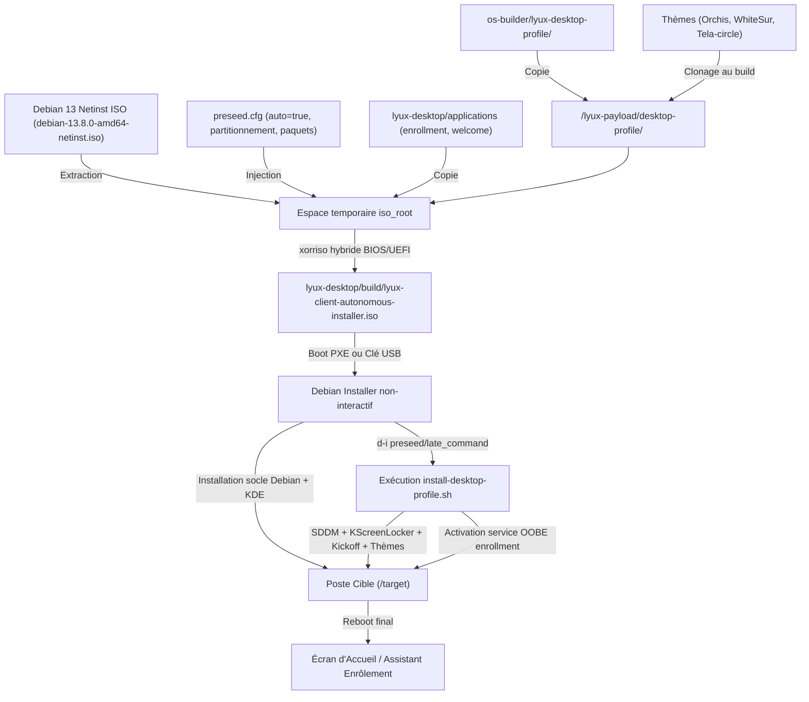

# 💿 Guide de Build Client ISO & Intégration du Profil Graphique LyuX

> **État : décrit la chaîne Preseed actuelle, qui embarque encore le profil graphique. Ce n'est pas l'architecture cible de personnalisation serveur.**
>
> La cible proposée est un client Debian 13 générique, suivi d'un enrôlement puis de l'application d'un profil versionné fourni par le serveur. Voir [PLAN_CLIENT_UNIVERSEL_PROFILS_SERVEUR.md](PLAN_CLIENT_UNIVERSEL_PROFILS_SERVEUR.md) pour les phases, les portes de validation et l'évaluation de Calamares. Calamares reste un candidat, pas une migration déjà réalisée.

---

## 1. Vue d'ensemble de l'Architecture

La chaîne actuellement présente dans le dépôt repose sur une **image Debian 13 (Trixie) Netinst officielle**, enrichie d'une installation **Preseed automatisée** et d'un **payload graphique/applicatif embarqué** directement sur le média. Cette approche est conservée pour les tests de l'installateur, mais elle embarque les thèmes dans chaque ISO et ne réalise pas encore le provisionnement dynamique cible depuis le serveur.

### Schéma du Pipeline



---

## 2. Pourquoi cette nouvelle méthode ?

1. **Reproductibilité & Zéro Dérive** : Fini les modifications manuelles sur une VM « master » à capturer. Tout est défini dans le dépôt Git `os-builder`.
2. **Indépendance Réseau (100% Hors-ligne)** : Dans un établissement scolaire, le réseau peut être filtré, sans DHCP immédiat ou soumis à un proxy avec authentification. L'ISO contient l'ensemble des dépôts de thèmes (Orchis, WhiteSur, Tela-circle) et les composants applicatifs dans `/lyux-payload/`.
3. **Zéro Question (Zero-Touch)** : L'installateur démarre en mode silencieux, formate le disque cible, installe KDE Plasma en français, déploie le visuel et redémarre directement sur l'assistant d'enrôlement LyuX.
4. **Taille Optimale** : L'ISO ne télécharge que les paquets stables officiels Debian, sans stockage redondant de gros disques virtuels de plusieurs dizaines de gigaoctets.

---

## 3. Comment Générer l'ISO Client

### Prérequis (sur Debian/Ubuntu ou VM de build Linux) :
```bash
sudo apt update
sudo apt install -y xorriso curl git isolinux 7z
```

### Commande de génération :
```bash
cd os-builder/lyux-iso-builder

# Optionnel : injecter un secret temporaire dans l'environnement du build.
# Ne jamais inscrire un vrai mot de passe ou une adresse d'établissement dans la documentation.
export LYUX_ADMIN_PASSWORD="<secret-temporaire>"
# export LYUX_APT_PROXY="<proxy-approuve>"

./build-client-iso.sh
```

Le script génère l'image dans :
`lyux-desktop/build/lyux-client-autonomous-installer.iso`

---

## 4. Intégration Détaillée des Thèmes & Personnalisations

Toutes les configurations graphiques proviennent du répertoire `os-builder/lyux-desktop-profile/` et sont appliquées par `install-desktop-profile.sh` exécuté dans l'environnement cible (`in-target`) via `preseed.cfg`.

### 4.1. Thèmes de Bureau (KDE Plasma)
- **Base visuelle** : Thème global **Orchis KDE** (`com.github.vinceliuice.Orchis`).
- **Décorations de fenêtres & Fonds d'écran** : **WhiteSur-Sharp** et wallpaper officiel WhiteSur.
- **Pack d'icônes** : **Tela-circle** (standard).
- **Curseurs** : **WhiteSur-cursors** / Breeze.
- **Polices système** : Famille typographique moderne **Inter** (`fonts-inter`).
- **Gestion hors-ligne** : Le script `build-client-iso.sh` clone ces thèmes dans `/lyux-payload/desktop-profile/themes/`. Lors de l'installation, `fetch_theme()` détecte leur présence locale et les installe directement sans solliciter Internet.

### 4.2. Écran de Connexion (SDDM)
- Dossier source : `lyux-desktop-profile/sddm/lyux-sddm`
- Configuration : `lyux-desktop-profile/sddm/99-lyux-theme.conf`
- **Caractéristiques** :
  - Session X11 imposée (`DisplayServer=x11`, `DefaultSession=plasmax11.desktop`) pour garantir la compatibilité Veyon et la stabilité graphique.
  - Masquage des comptes d'administration locaux (`HideUsers=lyux-admin,root`) afin que seuls les utilisateurs légitimes saisissent leurs identifiants.
  - Horloge, date et fond d'écran synchronisés avec la charte graphique LyuX.

### 4.3. Écran de Verrouillage Épuré (KScreenLocker)
- Dossier source : `lyux-desktop-profile/lockscreen/`
  - `LockScreenUi.qml`
  - `MainBlock.qml`
  - `UserDelegate.qml`
  - `ActionButton.qml`
  - `assets/` (icônes vectorielles personnalisées)
- **Modifications spécifiques LyuX** :
  - **Typographie premium** : Heure en **Inter ExtraLight 84px** blanche avec ombre portée douce (`#66000000`).
  - **Date lisible** : Date complète en français (`samedi 21 novembre 2026`) avec première lettre en majuscule.
  - **Saisie mot de passe** : Champ mot de passe stylisé sous forme de pilule en verre dépoli (`opacity: 0.85`), icône œil pour masquer/afficher, flèche d'envoi.
  - **Avatar circulaire** : Découpe nette avec bordure blanche fine.
  - **Suppression des actions perturbatrices** : Les boutons *Mettre en veille* et *Hiberner* ont été **totalement retirés**. Seul le bouton *Changer d'utilisateur* est conservé pour les postes partagés en classe.

### 4.4. Menu des Applications (Kickoff)
- Dossier source : `lyux-desktop-profile/kickoff/`
  - `LeaveButtons.qml`
  - `Footer.qml`
  - `NormalPage.qml`
- **Modifications spécifiques LyuX** :
  - **Suppression de l'onglet Emplacements** : Seul l'onglet *Applications* est affiché dans le pied de page (`Footer.qml`), éliminant la confusion pour les élèves.
  - **Élargissement de la barre des catégories** : `preferredSideBarWidth` fixé à **13 unités de grille** (~234px) dans `NormalPage.qml`, évitant toute coupure par ellipse (`...`) sur les libellés longs comme *Sciences et mathématiques* ou *Toutes les applications*.
  - **Actions d'alimentation maîtrisées** (`LeaveButtons.qml`) :
    - Boutons directs visibles : **Redémarrer** et **Éteindre**.
    - Menu déroulant *Quitter* : Restreint à **Verrouiller**, **Déconnexion** et **Changer d'utilisateur**.
    - Exclusion stricte de *Veille* et *Hiberner*.

### 4.5. Profil Utilisateur et Bureau par Défaut
- Dossier source : `lyux-desktop-profile/skel/`
  - `skel/.config/kdeglobals`, `plasmarc`, `plasmashellrc`, `kwinrc`, `kcminputrc`
  - `skel/Bureau/` : Raccourcis directs vers **Mon ENT**, **LibreOffice**, **Firefox ESR** et la **Corbeille**.
- Déployé dans `/etc/skel/` pour que tout profil nouvellement créé ou monté depuis le serveur central dispose immédiatement du bureau officiel prêt à l'emploi.

### 4.6. Démarrage Silencieux & OOBE
- `99-lyux-silent-boot.cfg` : Configure GRUB pour un amorçage invisible sans compte à rebours, avec affichage direct du splash Plymouth.
- `late_command` active `lyux-enrollment.service` et dépose `/etc/lyux/first-boot.flag` : le poste démarre directement sur l'assistant d'intégration au parc informatique.

---

## 5. Procédure de Test dans VirtualBox

1. Créer une VM de test :
   - Type : **Linux / Debian 64 bits**
   - RAM : **4096 Mo** (minimum 2048 Mo)
   - Disque : **20 Go**
   - Réseau : NAT ou Réseau Interne (`intnet`)
2. Attacher l'ISO générée `lyux-client-autonomous-installer.iso` au lecteur virtuel.
3. Démarrer la VM : l'installation s'exécute automatiquement sans aucune frappe clavier.
4. Au premier démarrage, vérifier :
   - Écran SDDM LyuX aux couleurs du projet.
   - Connexion et vérification du bureau (icônes bureau, dock centré, menu Kickoff épuré).
   - Verrouillage de session (`Ctrl+Alt+L` ou via le menu) : horloge blanche épurée, absence des boutons de veille.
