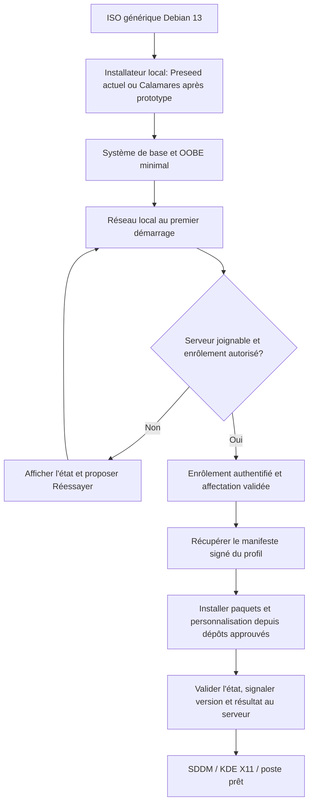

# Plan de migration vers le client LyuX universel

**État : proposition de mise en œuvre, pas encore une architecture entièrement implémentée.**
**Date : 24 novembre 2026**

Ce document décrit la cible souhaitée et les étapes pour y parvenir sans confondre l'installateur, le système de base et le provisionnement propre à chaque établissement.

## Objectif

Produire une image générique Debian 13 utilisable dans plusieurs établissements. Elle ne contient aucun identifiant, adresse de serveur, salle ou personnalisation propre à un lycée. Après son installation, le poste contacte le serveur LyuX, s'enrôle, puis reçoit un profil d'établissement contrôlé : présentation KDE, logiciels, paramètres de salle et composants LyuX.

Le serveur distribue des profils versionnés et des paquets vérifiables. Il ne transmet pas des scripts arbitraires ou des URL de thèmes saisies par un administrateur.

## Responsabilités des composants

### ISO et système de base

L'image contient le nécessaire pour installer et démarrer un système autonome : noyau, pilotes et firmware Debian nécessaires, réseau de premier démarrage, mécanisme d'installation, certificat de confiance LyuX, et assistant d'enrôlement graphique avec ses dépendances minimales.

**Décision retenue dans l'étape 0 :** la base KDE Plasma minimale est incluse dans l'ISO. Elle garantit un OOBE graphique au premier démarrage même sans accès au réseau ou au serveur LyuX.

Elle reste limitée au socle nécessaire: Plasma, SDDM en X11, aides Python de l'OOBE, réseau local et certificat de confiance. Les thèmes, logiciels lourds, restrictions propres aux établissements, Veyon, Samba et applications spécialisées sont livrés après enrôlement depuis des profils serveur vérifiés.

KDE Plasma 6 n'est pas téléchargé comme un thème : c'est un ensemble de paquets du système. La version installée et sa compatibilité sont déterminées par Debian 13 et le dépôt APT utilisé.

### Calamares

Calamares est un **candidat pour l'installateur graphique**, pas le gestionnaire de profils du serveur. Il peut gérer l'installation locale (disque, locale, compte local selon le choix retenu) et les scripts d'installation.

Avant de le retenir, un prototype doit démontrer qu'il s'intègre à l'image, fonctionne sans réseau, installe une VM de bout en bout et permet d'exécuter la même finalisation que le chemin actuel. Tant que ce prototype n'est pas validé, le Preseed actuel reste le chemin de référence pour les expériences.

### OOBE et enrôlement

Après l'installation et le premier redémarrage, l'OOBE LyuX configure le réseau si nécessaire, découvre ou demande l'adresse du serveur, teste l'API et exige une autorisation d'enrôlement. Il récupère du serveur la liste des bâtiments et salles; il ne permet pas de choisir librement des valeurs non validées.

Si le serveur est indisponible ou l'enrôlement est verrouillé, l'assistant affiche l'état et permet de réessayer. Il ne crée pas d'identité locale présentée comme enrôlée et ne marque pas le poste comme prêt.

### Serveur et personnalisation

Après authentification de l'enrôlement, le serveur associe le poste à un établissement, un bâtiment, une salle et un rôle. Il renvoie une référence de profil versionnée contenant des identifiants stables, par exemple `lyux-default`, `windows-style` ou `science-room`; les options réellement livrées restent celles du catalogue testé.

Le profil peut décrire :

- thème, couleurs, fond d'écran, icônes et disposition du bureau;
- modules KDE, raccourcis et restrictions Kiosk;
- paquets Debian ou Flatpak approuvés;
- paramètres Veyon et partages correspondant au rôle;
- politiques de mises à jour et de cache.

L'administrateur choisit parmi des options validées, globalement, par salle ou par rôle selon les capacités disponibles. Les restrictions de sécurité restent appliquées quel que soit le thème.

## Frontière d'hébergement

Le serveur LyuX héberge le plan de contrôle propre à l'établissement : état et autorisation d'enrôlement, inventaire, affectation bâtiment/salle/rôle, catalogue de profils approuvés, politiques et historique d'application. Il peut aussi distribuer les petits artefacts LyuX versionnés et signés nécessaires à ces profils.

Il ne devient pas un miroir général de tout l'écosystème logiciel :

- **Paquets Debian/KDE** : garder les dépôts Debian signés comme source d'autorité. Apt-Cacher-NG sert de cache des téléchargements réellement demandés; ce n'est pas un dépôt APT signé. Pour un établissement sans accès WAN, étudier un miroir partiel signé et limité aux paquets nécessaires, pas une copie complète par défaut.
- **Flatpak** : consommer Flathub ou un remote approuvé. Ne pas répliquer tout le catalogue; mettre en cache ou publier seulement les applications validées si le mode hors ligne le requiert.
- **Thèmes et assets** : les choisir dans un catalogue fermé et testé. Distribuer les variantes retenues sous forme d'artefacts versionnés/signés; aucun téléchargement d'URL arbitraire depuis l'Admin Panel ou le poste.
- **Code source et conteneurs** : GitHub reste la source de code. Les postes consomment des releases vérifiées, pas un dépôt Git HTTP ouvert ni des scripts exécutés directement à distance. Les images de conteneur sont épinglées par version/digest et mises en cache seulement si elles sont utilisées.
- **Outils d'exploitation** : réutiliser Samba-AD, Cockpit, GLPI, LAM, Veyon et Ansible pour leurs responsabilités établies au lieu de bâtir des équivalents LyuX.
- **Données scolaires** : garder identité, profils et inventaire sous le contrôle de l'établissement; ne pas rendre un compte cloud, une télémétrie externe ou un service tiers obligatoire pour démarrer un poste.

Principe de dimensionnement : héberger la politique et les données propres à LyuX; mettre en cache ce qui évite des téléchargements répétés; ne créer un dépôt local partiel que si une contrainte réelle de connectivité ou de disponibilité le justifie.

## Flux cible

## Plan étape par étape

### Étape 0 — Baseline et décisions

La baseline vérifiable de cette étape est disponible dans [BASELINE_ETAPE_0.md](BASELINE_ETAPE_0.md).

- Conserver l'état des modifications locales et l'ISO de référence.
- Répertorier les paquets strictement nécessaires au boot et à l'OOBE.
- Décision: Plasma minimal est inclus dans l'ISO; les profils et logiciels propres aux établissements sont appliqués après enrôlement.
- Faire un prototype isolé Calamares contre le Preseed actuel; comparer taille ISO, installation hors réseau, durée et facilité de diagnostic.
- Écrire les choix comme ADR seulement après démonstration et validation.

**Porte de sortie :** une décision documentée et une VM neuve qui démarre sur l'installateur sans blocage réseau/miroir.

### Étape 1 — Socle installable et reproductible ✅ (Validée le 24 novembre 2026)

- Garder l'image générique : aucune IP, compte de lycée, salle, thème choisi ou secret d'établissement fixé dans l'image.
- Séparer l'installation Debian du réseau du serveur LyuX. DHCP, le miroir Debian ou le proxy peuvent être utilisés uniquement pour résoudre le socle d'installation.
- Le Preseed utilise DHCP automatiquement pendant l'installation, puis conserve le socle Plasma et les dépendances minimales de l'OOBE.
- SSSD, CIFS, libpam-mount, Ansible et les logiciels d'établissement ne font plus partie du socle obligatoire d'installation.
- Installer seulement les composants nécessaires au système de base et à l'OOBE choisi.
- Faire échec explicite si une dépendance obligatoire manque; ne pas cacher les erreurs APT avec `|| true` pour les paquets essentiels.
- Garder les sorties de build dans un espace disque suffisant et vérifier le preseed réellement embarqué dans chaque ISO.

**Porte de sortie (validée) :** installation automatique sur disque vierge sans écran Debian de configuration réseau ou miroir, éjection du DVD et redémarrage répétable jusqu'à SDDM/X11 démontrés sur deux VM neuves (`LyuX-Step1-Val` et `LyuX-Step1-Val2`) avec `lyux-client-installer-latest.iso` (1 052 583 936 octets, SHA-256 `98E620980FBE70CC43A0A616A771FFE29197A715D42B634B06D461CA3EDC549E`).

### Étape 2 — OOBE et contrat d'enrôlement ✅ (Validée le 24 novembre 2026)

- Lancer l'OOBE graphique avant le bureau normal ou SDDM selon la séquence retenue (`xinit` + `lyux-oobe-session.sh` via `lyux-enrollment.service` sous `ConditionPathExists=/etc/lyux/first-boot.flag`).
- Obtenir une adresse DHCP ou permettre une configuration statique avant la connexion serveur.
- Séparer les erreurs réseau (`network-error`), API inaccessible (`server-unreachable`) et enrôlement verrouillé (`awaiting-authorization`).
- N'accepter que les bâtiments, salles, noms de poste et rôles retournés/validés par l'API.
- Rendre l'enrôlement idempotent via `client_id` stable et état atomique `/var/lib/lyux/enrollment-state.json` : un redémarrage ou une reprise ne doit pas créer un doublon.

**Porte de sortie (validée) :** serveur absent et enrôlement verrouillé sont des états récupérables; aucun faux fichier `enrolled.json` n'est écrit avant autorisation; enrôlement réel démontré sur `LyuX-Step1-Val` (`C14-PC03`, `BAT-C`/`C14`, `role=prof`) avec passage propre à SDDM.

### Étape 3 — Manifeste de profil et chaîne de confiance ✅ (Validée le 25 novembre 2026)

- Définir un schéma versionné pour le profil client (`lyux-profile-manifest` v1) : établissement, salle, rôle, thème, applications, restrictions et version.
- Authentifier l'administration et l'enrôlement.
- Signer les manifestes et artefacts en Ed25519 (`profile_trust.py`, `release_registry.py`); vérifier signature, empreinte SHA-256 et compatibilité côté client (`profile_manifest.py`) avant application.
- Éviter l'exécution directe d'un dépôt Git non authentifié ou de scripts provenant d'une URL arbitraire.
- Prévoir journal d'application, reprise, retour à un profil fonctionnel et gestion des profils retirés/révoqués.
- Prévoir le mode de déverrouillage d'administration/maintenance locale (`maintenance.py`) : soit par **clé FIDO2/U2F ou clé USB signée liée au numéro de série**, soit par **mot de passe administrateur local** PBKDF2.

**Porte de sortie (validée) :** le client rejette un manifeste non signé, corrompu, inconnu, expiré ou incompatible, et effectue un rollback automatique vers le dernier profil valide en cas d'échec.

### Étape 4 — Dépôts et installation des personnalisations (Implémentée, validation VM hors-ligne à finaliser)

- Publier les paquets Debian dans un dépôt APT signé (`apt_repo.py`, `/api/v1/apt-repo/...`) ou dans une source amont de confiance mise en cache; `apt-cacher-ng` seul n'est pas un dépôt signé.
- Publier les Flatpak dans un dépôt Flatpak approuvé (`APPROVED_FLATPAKS`) si cette voie est retenue.
- Servir les thèmes KDE et assets depuis un dépôt versionné; le client (`profile_applier.py`) n'accepte que des identifiants du catalogue.
- Rendre l'application technique idempotente sans exposer un shell d'administration général au poste.
- Définir le comportement si un paquet ou un thème est absent : garder le profil de secours (`rollback_profile`) et signaler l'échec (`POST /api/v1/client/profile-report`).

**Porte de sortie :** un profil est appliqué depuis un serveur LAN sans accès Internet, avec preuve des versions et empreintes utilisées.

### Étape 5 — Personnalisation administrateur ✅ (Validée le 25 novembre 2026)

- Ajouter au panneau une sélection à partir du catalogue signé : thème, applications et profil de salle.
- Montrer une prévisualisation et la portée du changement avant publication.
- Appliquer d'abord à un groupe pilote ou une VM, puis planifier la propagation.
- Permettre retour au profil LyuX par défaut et conserver un journal d'audit.

**Porte de sortie :** un administrateur peut changer un choix limité sans modifier des scripts, QML, URL ou secrets.

### Étape 6 — Tests et déploiement

Tester au minimum :

- VM neuve sans DHCP et sans serveur;
- VM neuve avec DHCP, sans serveur LyuX;
- serveur joignable, enrôlement verrouillé;
- enrôlement autorisé, profil standard;
- profil avec une variante visuelle et logiciels;
- dépôt indisponible, paquet absent, manifeste invalide et coupure durant le téléchargement;
- redémarrage, ré-enrôlement, retour au profil de secours et mises à jour signées.

Exécuter les suites depuis leurs dépôts (`os-builder`, `lyux-desktop`, `lyux-server`), puis vérifier le boot BIOS/UEFI, le premier démarrage, SDDM X11, l'OOBE, le profil appliqué et le SHA-256 de l'ISO.

**Fermeture d'un ticket :** ne fermer qu'après succès des critères de son périmètre et preuve par les tests/VM concernés. Le simple succès du build ou du validateur ISO ne prouve pas l'installation ni le provisionnement serveur.

## État actuel et limites connues

- L'ISO de travail actuelle est construite depuis Debian 13 Netinst et le preseed; elle embarque encore un large payload de thèmes et de profils.
- La chaîne actuelle a été testée jusqu'à la configuration d'installation; elle n'a pas encore démontré une installation complète jusqu'à l'OOBE et l'application de profil serveur.
- Les endpoints de distribution/version côté `lyux-server` sont actuellement incomplets ou simulés; la personnalisation décrite ici est une cible à implémenter, pas une capacité déjà livrée.
- L'issue `lyux-os-builder#16` suit le blocage de l'installateur et doit rester ouverte jusqu'à une installation complète.
- Calamares reste à évaluer dans l'étape 0; aucune migration n'est engagée par ce plan seul.

## Issues de suivi

- `Luux-Manchot/lyux-os-builder#7` : choix du support installable et prototype Calamares.
- `Luux-Manchot/lyux-os-builder#9` : client universel et OOBE piloté par le serveur.
- `Luux-Manchot/lyux-os-builder#12` : secrets et configuration propre à l'établissement.
- `Luux-Manchot/lyux-os-builder#14` : profils visuels et catalogue de thèmes.
- `Luux-Manchot/lyux-os-builder#16` : installation silencieuse actuelle et validation VM.
- `Luux-Manchot/lyux-server#12` : distribution des profils et logiciels.
- `Luux-Manchot/lyux-server#14` et `#16` : décision et socle signé de versions/artefacts.
