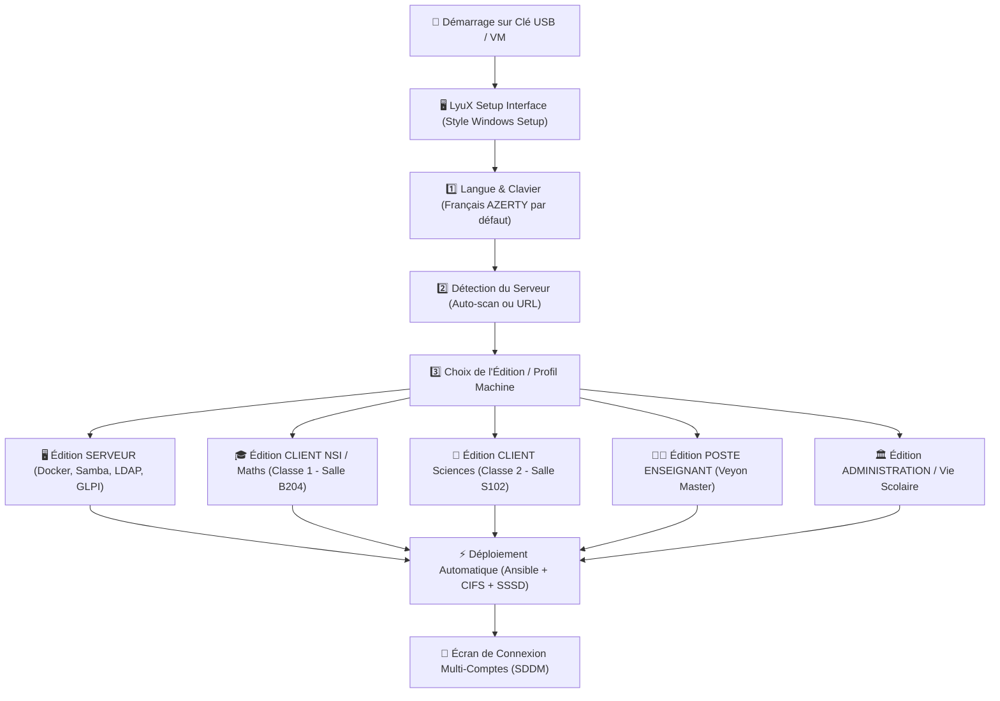

# 💿 Guide de la Clé USB Bootable & Sélecteur d'Éditions LyuX

> **Opération Manchot — Système de déploiement universel "Style Windows Setup"**

---

## 🎯 Concept & Objectif

Tout comme l'installateur Windows permet de choisir lors du démarrage entre *Windows 11 Famille*, *Professionnel* ou *Entreprise*, l'image bootable **LyuX Universal Installer** permet de transformer n'importe quel ordinateur du lycée en 1 clic grâce à un **menu graphique interactif**.

---

## 📦 Matrice des 5 Éditions LyuX

| Édition LyuX | Destination / Salle | Logiciels & Configuration Inclus | Rôle dans l'établissement |
| :--- | :--- | :--- | :--- |
| **LyuX Serveur d'Établissement** | Baie Serveur / Salle Serveur | Stack Docker (Traefik, GLPI, LAM LDAP, Apt-Cacher, Supervision Uptime Kuma), Partages CIFS/NFS. | Cœur du réseau scolaire |
| **LyuX Client NSI / Maths** | Classe 1 (Salle B204) | KDE Plasma Kiosk, Thonny IDE, VS Code, Python 3, Git, Veyon Client, Clavier AZERTY, Montage `//homes` & `//classes/B204`. | Postes élèves programmation |
| **LyuX Client Sciences** | Classe 2 (Salle S102) | KDE Plasma Kiosk, Avogadro 3D, Tracker Vidéo, LibreOffice, GIMP, Veyon Client, Montage `//classes/S102`. | Postes élèves TP chimie/physique |
| **LyuX Poste Enseignant** | Bureau Professeur (toutes salles) | KDE Plasma complet, **Veyon Master** (supervision en direct, verrouillage d'écran), Outil de réinitialisation express des mots de passe. | Pilotage pédagogique en classe |
| **LyuX Administration** | Vie Scolaire & Direction | KDE Plasma, Accès direct Pronote, GLPI Helpdesk, LAM, Suite bureautique complète. | Gestion de l'établissement |

---

## 🚀 Fonctionnement du Déploiement

1. **Amorçage immédiat** : La clé USB démarre un environnement graphique minimal en mémoire vive (RAM) en 10 secondes.
2. **Détection du serveur** : L'assistant interroge `http://serveur.lyux.lan:8000` (ou `http://10.0.2.2:8000` en VM).
3. **Validation OTP** : Le technicien saisit ou valide le jeton de sécurité (`LYUX-DEMO-2026`).
4. **Écriture & Configuration** :
   - Le nom d'hôte est généré automatiquement (ex: `b204-pc01`, `s102-pc02`).
   - Les règles PAM et SSSD sont appliquées pour autoriser tous les comptes élèves et profs.
   - Les dossiers réseau `/home/<utilisateur>` et `/classes/<salle>` sont branchés.
5. **Prêt à l'emploi** : Redémarrage automatique sur l'écran de connexion SDDM où chaque élève et enseignant peut se connecter immédiatement avec son mot de passe.
