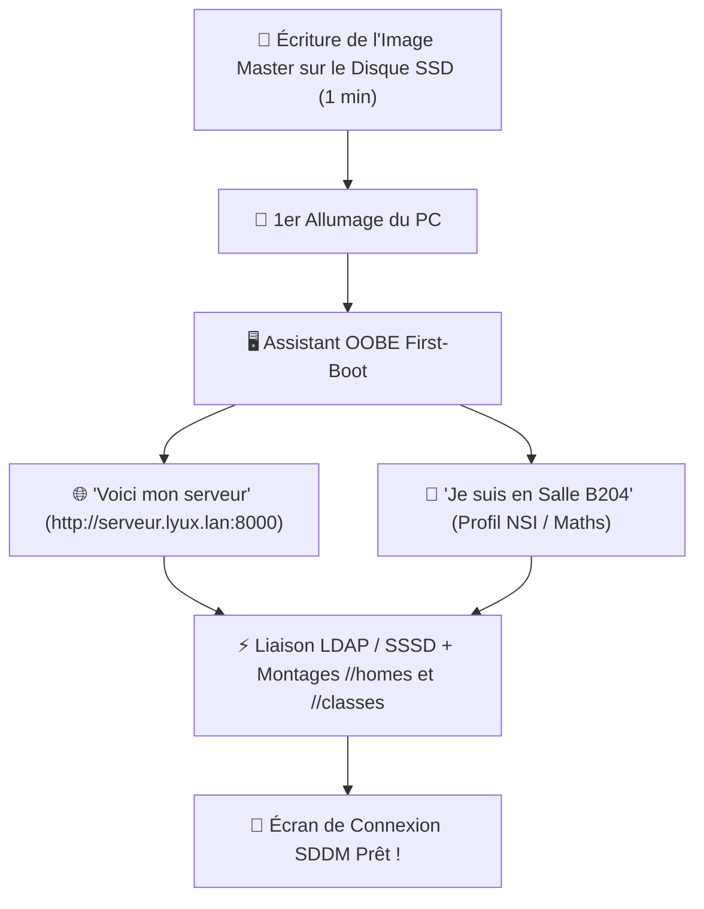

# 🚀 Déploiement par Image Master Disque & OOBE (Modèle OEM / Style Windows)

> **Opération Manchot — Système de mise en service ultra-rapide des postes du lycée**

---

## 🎯 Le Principe : Déploiement "Zero-Friction"

Pour équiper 200 à 500 ordinateurs dans un lycée sans passer par des heures d'installation manuelle par machine, **LyuX** adopte le standard industriel utilisé par les constructeurs (OEM) et les déploiements Windows d'entreprise :

1. **L'Image Disque Master Pré-construite** : Le système Linux (Debian 13 Trixie + KDE Plasma + pilotes graphiques + outils scolaires) est pré-installé dans une image disque (`.raw`, `.img`, `.vdi` ou Clonezilla).
2. **Le Déploiement Disque (1 à 2 minutes)** : L'image est écrite sur le disque SSD du PC (par clé USB rapide ou multicast réseau Clonezilla / FOG).
3. **Le 1er Allumage (First Boot OOBE)** : La machine s'allume instantanément sur l'assistant graphique :
   - On confirme la langue (Français AZERTY par défaut).
   - On sélectionne le serveur (détection automatique sur le réseau scolaire).
   - On choisit la salle (ex: *Salle B204 Informatique* ou *Salle S102 Sciences*).
   - On clique sur **"Terminer"**.
4. **Prêt Immédiat** : Le service OOBE s'éteint, et l'écran de session SDDM apparaît : tous les élèves et professeurs peuvent se connecter directement.



---

## 🏫 Les 2 Classes Pilotes Pré-configurées

Toutes les machines de test des 2 classes sont déjà configurées et raccordées au serveur :

### 🔵 Classe 1 : Salle B204 (1G1 — Informatique NSI & Maths)
* **Poste Enseignant** : `b204-prof` • M. Durand (`thomas.durand` / `Prof2026!`) — *Supervision Veyon Master*
* **Poste Élève 01** : `b204-pc01` • Lucas Martin (`lucas.martin` / `Eleve2026!`) — *Thonny IDE Python & VS Code*
* **Poste Élève 02** : `b204-pc02` • Emma Bernard (`emma.bernard` / `Eleve2026!`) — *LibreOffice & Devoirs NSI*

### 🟣 Classe 2 : Salle S102 (1G2 — Sciences & Physique-Chimie)
* **Poste Enseignant** : `s102-prof` • Mme Leroy (`sophie.leroy` / `Prof2026!`) — *Supervision Veyon Master*
* **Poste Élève 01** : `s102-pc01` • Hugo Dubois (`hugo.dubois` / `Eleve2026!`) — *Avogadro 3D & Tracker*
* **Poste Élève 02** : `s102-pc02` • Léa Thomas (`lea.thomas` / `Eleve2026!`) — *Mesures & Calculs Calc*

---

## 🛠️ Le Service Système OOBE (`lyux-oobe.service`)

Sur le disque du client, un service Systemd one-shot s'exécute uniquement au premier démarrage :

```ini
[Unit]
Description=LyuX Out-Of-The-Box First Boot Configuration
After=network-online.target
ConditionPathExists=/etc/lyux/first-boot.flag

[Service]
Type=oneshot
ExecStart=/usr/bin/python3 /opt/lyux/oobe/oobe_gui.py --fullscreen
ExecStartPost=/bin/rm -f /etc/lyux/first-boot.flag
StandardOutput=journal

[Install]
WantedBy=graphical.target
```

Dès la validation de l'assistant, le fichier `/etc/lyux/first-boot.flag` est supprimé, et la machine démarre ensuite directement sur l'environnement scolaire final.
