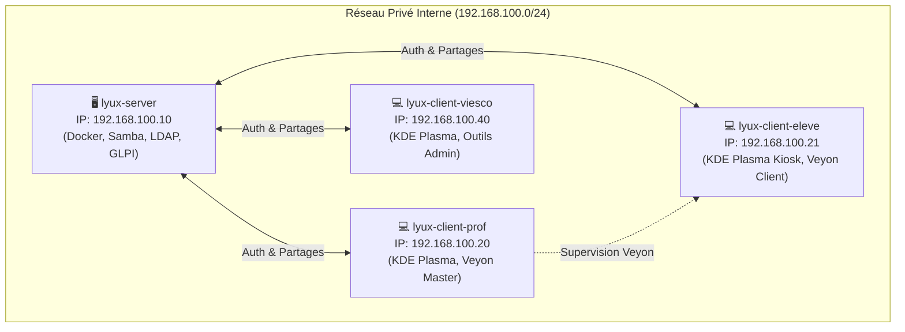

# 🧪 LyuX Lab Multi-VM
> **Environnement virtuel de test complet (Serveur + Prof + Élève + Vie Scolaire).**

Ce sous-projet permet d'instancier et tester l'ensemble de l'écosystème **LyuX / Opération Manchot** sur une seule machine de développement (via **Vagrant & VirtualBox** ou **Proxmox**).

---

## 🖥️ Topologie du Lab Virtuel



---

## 🚀 Démarrage en 1 Commande (avec Vagrant)

1. **Prérequis** : Avoir installé [VirtualBox](https://www.virtualbox.org/) et [Vagrant](https://developer.hashicorp.com/vagrant/downloads).
2. **Lancer tout le lab** :
   ```bash
   cd projects/lyux-lab-vm
   vagrant up
   ```
3. **Ou démarrer seulement le serveur et 1 poste élève** :
   ```bash
   vagrant up server eleve
   ```

---

## 🔑 Comptes de Test Pré-configurés

| Identifiant | Mot de Passe par Défaut | Rôle & Groupe | Accès & Privilèges |
| :--- | :--- | :--- | :--- |
| `prof.durand` | `Prof2026!` | `enseignants` | Veyon Master, Partage Profs, Réinit MDP |
| `eleve.dupont` | `Eleve2026!` | `eleves` | Bureau verrouillé Kiosk, Espace Personnel |
| `admin.scolaire` | `Admin2026!` | `viesco` | Accès LAM, GLPI, Gestion Vie Scolaire |
| `lyux-admin` | `LyuxRoot2026!` | `techniciens` / `sudo` | Administration système & SSH |

---

## 📂 Structure

```
lyux-lab-vm/
├── Vagrantfile                 # Définition des 4 machines virtuelles
├── scripts/
│   ├── provision-server.sh     # Déploiement automatique du serveur
│   └── provision-client.sh     # Déploiement automatique des clients KDE
├── docs/
│   ├── guide-lab-virtualbox.md # Guide de configuration manuelle VirtualBox
│   └── guide-lab-proxmox.md    # Guide de déploiement en grappe Proxmox
└── README.md
```
